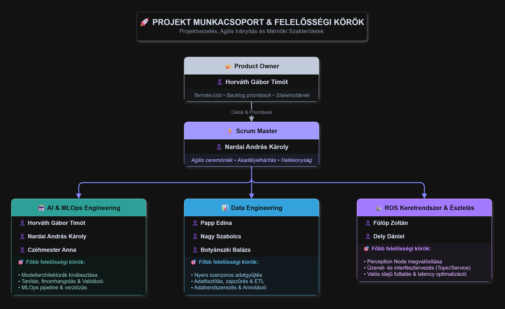
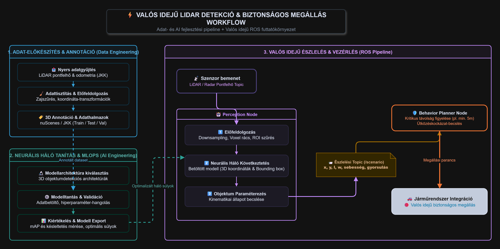

# 🚀 Projekt Munkacsoport & Felelősségi Körök

> A projekt célja egy valósidejű szoftver létrehozása amely Lidar/Radar szenzorokból kapott adat pontfelhőből mesterséges neurális hálózatok segítségével detektálni tud egy objektumot, majd ezt egy személygépjárműbe integrálva valós időben biztonságos megállást tud végrehajtani az autón.

---

## 🧭 Projektvezetés & Agilis Irányítás

## 👥 Munkacsoport felépítése

  

A döntéshozatalért, a követelmények prioritásáért és a folyamatos, akadálymentes agilis munkamenetért felelős vezetők:

| Szerepkör | Felelős | Elsődleges fókusz |
| :--- | :--- | :--- |
| **👑 Product Owner** | **Horváth Gábor Timót** | Termékvízió, követelménymenedzsment, backlog prioritások, stakeholderek kezelése |
| **⚡ Scrum Master** | **Nardai András Károly** | Agilis ceremóniák moderálása, akadályok elhárítása, csapatdinamika, hatékonyság |

---

## 🛠️ Mérnöki Szakterületek & Feladatkörök

### 1. 🤖 AI & MLOps Engineering
*Korszerű mélytanulási modellek életciklus-kezelése a koncepciótól a produkciós integrációig.*

* **Csapattagok:**
  * **Horváth Gábor Timót**
  * **Nardai András Károly**
  * **Czéhmester Anna**
* **Főbb felelősségi körök:**
  * 🎯 **Modellarchitektúrák kiválasztása:** A feladathoz legoptimálisabb mélytanulási hálózatok felkutatása és kiválasztása.
  * 🔬 **Tanítás és finomhangolás:** Hiperparaméter-optimalizáció, kísérletezés, loss-függvények hangolása.
  * 🧪 **Tesztelés & Validáció:** Metrikák (mAP, pontosság, késleltetés) mérése és kiértékelése.
  * ⚙️ **MLOps:** Reprodukálható pipeline-ok, verziózás (modell- és kódkövetés), automatizált kiértékelés.

---

### 2. 📊 Data Engineering
*A modellek tanításához és validálásához szükséges robusztus adatbázis megteremtése és kezelése.*

* **Csapattagok:**
  * **Papp Edina**
  * **Nagy Szabolcs**
  * **Botyánszki Balázs**
* **Főbb felelősségi körök:**
  * 📥 **Adatgyűjtés:** Nyers adatok begyűjtése szenzorokból és külső forrásokból.
  * 🧹 **Adattisztítás:** Hibás, hiányzó vagy zajos rekordok szűrése és anomáliák kezelése.
  * 🔄 **Adatbetöltés & ETL:** Automatizált betöltési és transzformációs folyamatok kialakítása.
  * 🗂️ **Adatrendszerezés & Annotáció:** Adathalmazok címkézése, strukturálása, tanító/validációs partíciók kialakítása.

---

### 3. 🦾 ROS Keretrendszer & Észlelés (Perception)
*A szoftver és a robotikai hardver közötti híd megteremtése, valós idejű észlelési csomópontok implementálása.*

* **Csapattagok:**
  * **Fülöp Zoltán**
  * **Dely Dániel**
* **Főbb felelősségi körök:**
  * 📡 **Perception Node megvalósítása:** A detektáló modellek beágyazása és futtatása a ROS hálózatban.
  * 🔌 **Üzenet- és interfésztervezés:** Topicok, service-ek és szabványos ROS észlelési üzenettípusok kezelése.
  * ⚡ **Valós idejű futtatás:** Késleltetési (latency) optimalizáció és hardveres kommunikáció összehangolása.

## A fejlesztési folyamat workflow-ja.

  

---

## 📋 Összesített Csapatmátrix

| Név | Munkacsoport | Szerepkör |
| :--- | :--- | :--- |
| **Horváth Gábor Timót** | Vezetés / AI | Product Owner |
| **Nardai András Károly** | Vezetés / AI | Scrum Master, AI Engineer |
| **Czéhmester Anna** | Fejlesztés | AI Engineer |
| **Papp Edina** | Fejlesztés | Data Engineer |
| **Nagy Szabolcs** | Fejlesztés | Data Engineer |
| **Botyánszki Balázs** | Fejlesztés | Data Engineer |
| **Fülöp Zoltán** | Fejlesztés | ROS & Perception Engineer |
| **Dely Dániel** | Fejlesztés | ROS & Perception Engineer |

---

> 💡 **Megjegyzés a munkamenethez:** Az átfedések (pl. AI modellek átadása a ROS perception csomópontnak, vagy az adattisztított adathalmazok bejuttatása a tanítási pipeline-ba) szoros napi kommunikációt és rendszeres sprint áttekintéseket (Review/Retro) igényelnek.
